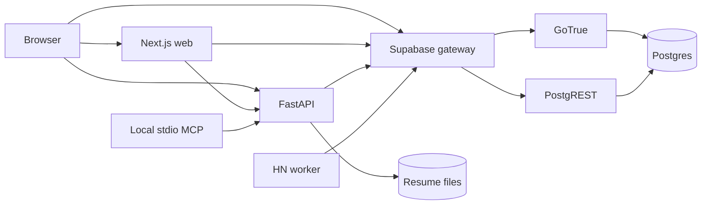

# Architecture

[[Home]] · [[Data and Authentication]]

| Path | Responsibility |
| --- | --- |
| backend/app/api/routes/ | HTTP endpoints |
| backend/app/core/ | Settings, auth, Supabase clients |
| backend/app/api/deps.py | User resolution and first profile/plot creation |
| backend/app/services/ | Scoring, resume parsing, identity, world placement |
| backend/app/schemas/ | Request/response models |
| frontend/src/app/ | Next.js pages and auth handlers |
| frontend/src/lib/ | API/Supabase helpers and types |
| mcp/athena_mcp/ | API client and MCP tools |
| worker/athena_worker/ | Ingestion and captured-listing parsing |
| supabase/migrations/ | Schema and RLS |
| supabase/docker/ | Database initialization |
| supabase/gateway/ | Auth/REST routing |

Base Compose runs db, auth, rest, gateway, api, web, and worker. MCP runs separately on the user's machine. Local ports: web 3000, API 8000, gateway 8001.

Browser bundles use public URLs. Server-side frontend requests use API_INTERNAL_URL and SUPABASE_INTERNAL_URL within Docker. Public frontend settings are baked into the build.

Production adds outer Caddy HTTPS routing and removes direct host publishing of web/API/gateway. Self-hosted Realtime is intentionally absent; refresh the world page for others' changes.

Sources: [Compose](../docker-compose.yml), [production overlay](../docker-compose.prod.yml).
